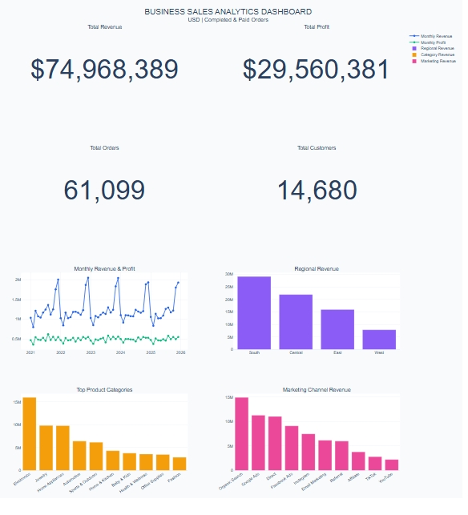

# Business Sales Performance Analytics

## Project Overview
This project focuses on analyzing e-commerce business sales data to identify revenue trends, product performance, customer purchasing behaviour, regional sales patterns, marketing performance, delivery operations, and customer satisfaction.

The project uses Python and data analytics techniques to transform raw sales data into meaningful business insights and actionable recommendations.

## Project Objectives
- Analyze overall sales and revenue trends.
- Identify top-performing products and categories.
- Evaluate regional sales and profitability.
- Understand customer purchasing behaviour using RFM analysis.
- Analyze marketing channels and discount performance.
- Evaluate delivery performance and product returns.
- Study customer ratings and satisfaction.
- Develop an interactive business sales dashboard.

## Tools & Technologies
- Python
- Pandas
- NumPy
- Matplotlib
- Seaborn
- Plotly
- Jupyter Notebook
- Anaconda

## Key Performance Indicators (USD Analysis)

The financial analysis focuses on completed and paid USD orders.

| KPI | Result |
|---|---:|
| Total Revenue | $74.97 Million |
| Total Profit | $29.56 Million |
| Total Orders | 61,099 |
| Unique Customers | 14,680 |
| Total Quantity Sold | 348,703 |
| Average Order Value | Approximately $1,227 |
| Profit Margin | 39.43% |

## Analysis Covered

### 1. Sales Performance
- Overall revenue and profit analysis.
- Yearly and monthly sales trends.
- Order volume analysis.

### 2. Product Performance
- Top-selling products.
- Product category revenue and profitability.
- Product-level financial validation.

### 3. Regional Performance
- Revenue and profit comparison across regions.
- Identification of high-performing regions.

### 4. Customer Analytics
- Customer purchasing frequency.
- RFM customer segmentation.
- Customer loyalty and retention analysis.

### 5. Marketing Analytics
- Marketing channel performance.
- Campaign tracking analysis.
- Discount analysis.

### 6. Delivery & Returns
- Delivery time and delay analysis.
- Return rate and return reason analysis.

### 7. Customer Satisfaction
- Customer rating analysis.
- Relationship between delivery performance and ratings.

## Interactive Dashboard

### Dashboard Preview



[View Interactive Dashboard]
(https://lakshmipadmaja.github.io/FUTURE_DS_01/dashboard/Business_Sales_Interactive_Dashboard.html)


[View Interactive Dashboard](dashboard/Business_Sales_Interactive_Dashboard.html)

An interactive dashboard was developed using Plotly to present business performance insights through visualizations.

Dashboard file: `dashboard/Business_Sales_Interactive_Dashboard.html`

## Project Structure

```text
FUTURE_DS_01/
│
├── notebooks/
│   └── Business_Sales_Analysis.ipynb
│
├── dataset/
│   └── Source datasets
│
├── visualizations/
│   └── Generated charts
│
├── dashboard/
│   └── Business_Sales_Interactive_Dashboard.html
│
├── reports/
│   └── Business_Sales_Analytics_Report.pdf
│
├── README.md
├── requirements.txt
└── .gitignore
```

## How to Run the Project

1. Clone or download this repository.
2. Install Python and Anaconda.
3. Install the required libraries:

```bash
pip install pandas numpy matplotlib seaborn plotly jupyter openpyxl
```

4. Open Jupyter Notebook.
5. Open `notebooks/Business_Sales_Analysis.ipynb`.
6. Update dataset paths if required.
7. Run the notebook cells in sequence.

## Key Insights
- The South region generated the highest USD revenue and profit.
- Electronics recorded the highest category revenue.
- Grocery achieved the highest category profit margin.
- Repeat customers contributed significantly to overall revenue.
- Organic Search was the highest-revenue recorded marketing channel.
- Delivery delays and customer ratings showed a negative relationship.

## Recommendations
- Focus on high-performing products and profitable categories.
- Strengthen sales strategies in high-performing regions.
- Improve customer retention through loyalty programs.
- Improve delivery operations to reduce delays.
- Enhance marketing campaign tracking.
- Monitor product returns and customer feedback.

## Data & Methodology Notes
- Financial KPIs are calculated using completed and paid USD orders.
- Different currencies are not combined without currency conversion.
- Product-level records were reconciled with order-level financial totals.
- Marketing campaign tracking is incomplete, and advertising spend data was unavailable; therefore, ROAS and marketing ROI could not be calculated.
- Findings are descriptive and depend on the quality and completeness of the available dataset.

## Author
**Gonchala Lakshmi Padmaja**

BCA Honors – Data Science

## Internship
**Future Interns – Data Science & Analytics**

**Task 1: Business Sales Performance Analytics**
